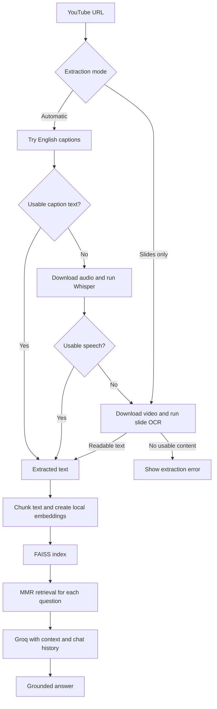

<div align="center">

# YouTube RAG Assistant

### Turn videos into conversations.

Ask questions about YouTube videos using captions, speech, or on-screen slide text — powered by Groq and a local retrieval pipeline.


**YouTube captions · Whisper speech recognition · Slide OCR · Conversational Q&A**

</div>

---

## Overview

YouTube RAG Assistant is a Streamlit app that extracts content from a YouTube video and lets you ask questions about it. It first tries captions, falls back to local Whisper transcription, and uses OCR when usable speech is unavailable. A dedicated **Slides only (OCR)** mode lets you read presentations directly.

Extracted text is split into chunks, embedded locally, and indexed in FAISS. For each question, relevant passages and conversation history are sent to a Groq-hosted model to generate an answer grounded in the extracted content.

> If the retrieved content does not support an answer, the assistant is instructed to explicitly say that the information was not found, rather than fill the gap with general knowledge.

## Features

| Feature | What it does |
| --- | --- |
| Automatic extraction | Tries English YouTube captions, then Whisper, then slide OCR |
| Slides-only mode | Bypasses captions and speech to read on-screen text directly |
| Local speech recognition | Uses multilingual faster-whisper on CPU with voice activity detection |
| English and Hindi OCR | Choose English or Hindi + English for slide recognition |
| Adjustable frame sampling | Reads a frame every 5 seconds by default; 2- and 3-second options are available |
| Extraction visibility | Shows processing progress, the successful extraction source, and a text preview |
| Semantic retrieval | Uses local MiniLM embeddings and FAISS with MMR search |
| Conversational chat | Keeps session history for follow-up questions and offers Clear Chat |
| Grounded responses | Instructs the model to report missing information explicitly |
| Temporary-file cleanup | Removes downloaded audio and video after extraction |

## How it works



Sound-cue-only captions, such as `[Music]` and `[Applause]`, are treated as unusable and trigger fallback extraction. In automatic mode, OCR runs only if captions and speech do not provide usable content.

## Tech stack

| Layer | Tools |
| --- | --- |
| Interface | Streamlit |
| RAG orchestration | LangChain |
| Answer generation | Groq via `langchain-groq` |
| Text embeddings | Sentence Transformers — `all-MiniLM-L6-v2` |
| Vector search | FAISS |
| Captions | YouTube Transcript API |
| Media download | yt-dlp |
| Speech to text | faster-whisper |
| Slide text recognition | EasyOCR, OpenCV, PyTorch |
| Configuration | python-dotenv |

## Run locally

### 1. Clone the repository

```bash
git clone https://github.com/AKSH4T-13/Youtube-Assistant.git
cd Youtube-Assistant
```

### 2. Create and activate a virtual environment

**Windows PowerShell**

```powershell
python -m venv .venv
.\.venv\Scripts\Activate.ps1
```

**macOS / Linux**

```bash
python3 -m venv .venv
source .venv/bin/activate
```

### 3. Install dependencies

```bash
python -m pip install --upgrade pip
python -m pip install -r requirements.txt
```

For YouTube download support, install **Node.js or Deno** and make sure it is available on `PATH`. The downloader detects these runtimes automatically. No separate FFmpeg executable is required by the current single-stream download and faster-whisper workflow.

### 4. Configure your API key

Create a `.env` file in the project root:

```dotenv
GROQ_API_KEY=your_groq_api_key
GROQ_MODEL=openai/gpt-oss-120b
WHISPER_MODEL=base
```

| Variable | Required | Purpose |
| --- | --- | --- |
| `GROQ_API_KEY` | Yes | Authenticates requests for answer generation |
| `GROQ_MODEL` | No | Defaults to `openai/gpt-oss-120b` |
| `WHISPER_MODEL` | No | Defaults to the multilingual `base` model |

Keep real API keys out of source control. The `.env` file is ignored by Git.

### 5. Start the app

```bash
python -m streamlit run app.py
```

Open **http://localhost:8501** in your browser.

> The first use of embeddings, Whisper, or OCR may download model files. Allow extra time and ensure an internet connection is available. Whisper and OCR models are reused within the running process.

## Using the app

1. Paste a YouTube video URL.
2. Choose **Automatic** for captions and speech, or **Slides only (OCR)** for presentations and silent screen recordings.
3. For OCR, open **Slide reading settings** and select the language and sampling interval. The UI defaults to **English** and **5 seconds**.
4. Click **Load Video** and wait for extraction and indexing to finish.
5. Check **Extraction source** and **Extracted text preview** to confirm what the app actually read.
6. Ask questions in the chat. Use **Clear Chat** to reset conversation history.

After changing extraction settings, load the video again to rebuild its index.

### Example questions

- “Summarize the main points discussed in this video.”
- “Which precautions are listed in the presentation?”
- “What function names are visible in the extracted code?”
- “Explain the second point in simpler words.”

For OCR testing, ask about specific words or labels visible on a slide and compare the answer with the extracted text preview.

## Project structure

| File | Responsibility |
| --- | --- |
| `app.py` | Streamlit interface, extraction settings, progress, preview, and chat |
| `main.py` | Caption extraction, chunking, embeddings, retrieval, and Groq chain |
| `extractors.py` | Media downloads, Whisper transcription, OCR, and fallback handling |
| `requirements.txt` | Python dependencies |
| `test_extractors.py` | Extraction and fallback regression tests |
| `.gitignore` | Excludes secrets, virtual environments, and generated data |

## RAG configuration

| Setting | Current value |
| --- | --- |
| Chunk size / overlap | 1,000 / 200 characters |
| Embedding model | `sentence-transformers/all-MiniLM-L6-v2` |
| Retrieval strategy | Maximum Marginal Relevance (MMR) |
| Retrieved chunks / candidate chunks | 4 / 12 |
| MMR diversity parameter | `lambda_mult=0.7` |
| LLM temperature | `0.2` |
| Chat storage | In-memory Streamlit session |

## Limitations

- **Extraction takes time.** Whisper and OCR run on CPU; long videos and first-time model downloads can be slow.
- **Slides can be missed.** OCR samples fixed intervals, so content shown for less than the selected interval may be skipped. Repeated slides are not deduplicated.
- **OCR reads text.** It does not interpret diagrams, charts, or images, and small or blurry text may be misread.
- **Automatic mode stops at the first usable source.** Successful captions or speech prevent slide scanning. Use Slides only for visual content.
- **Recognition can be imperfect.** Music or noise may produce incorrect speech text. Inspect the preview and switch to Slides only when appropriate.
- **Caption fetching currently requests English.** Whisper is multilingual, and OCR supports the English/Hindi options exposed in the UI. Hindi retrieval quality can vary because the embedding model is English-focused.
- **Retrieval is selective.** Only a few chunks reach the model. Missing retrieved information does not prove that the entire video lacks it. Answers can still be wrong and should be checked against the source.
- **Follow-up retrieval uses the current question.** Conversation history is supplied to the model, but the search query is not rewritten from history.
- **Access restrictions still apply.** Private, deleted, restricted, or download-blocked videos may fail. Hosting IP restrictions can also affect extraction.
- **Sessions are temporary.** The app does not persist chat history or vector indexes across sessions, and it does not provide a dedicated source-citation interface. Whisper/OCR timestamps are included in extracted text when available.

## Troubleshooting

| Issue | What to try |
| --- | --- |
| `No module named yt_dlp` or `torchvision` | Install `requirements.txt` using the same Python environment that starts Streamlit |
| No supported JavaScript runtime | Install Node.js or Deno, confirm it is on `PATH`, then restart the app |
| Interrupted media download | Retry loading the video and update with `python -m pip install -U "yt-dlp[default]"` |
| OCR is slow | Choose English and keep the 5-second interval; try a shorter video |
| Preview contains music cues or incorrect speech | Select Slides only (OCR) and load the video again |
| Answer says information was not found | Inspect the preview; the content may not have been extracted or retrieved |
| `GROQ_API_KEY is missing` | Add the key to `.env` and restart Streamlit |

Whisper, OCR, embeddings, and FAISS run locally. Retrieved passages, conversation history, and your question are sent to Groq for answer generation.
